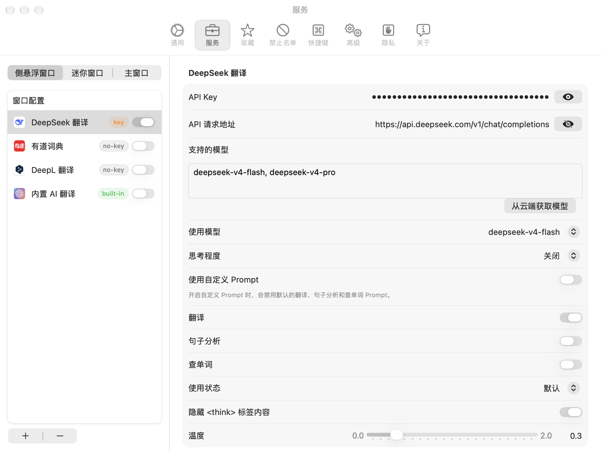
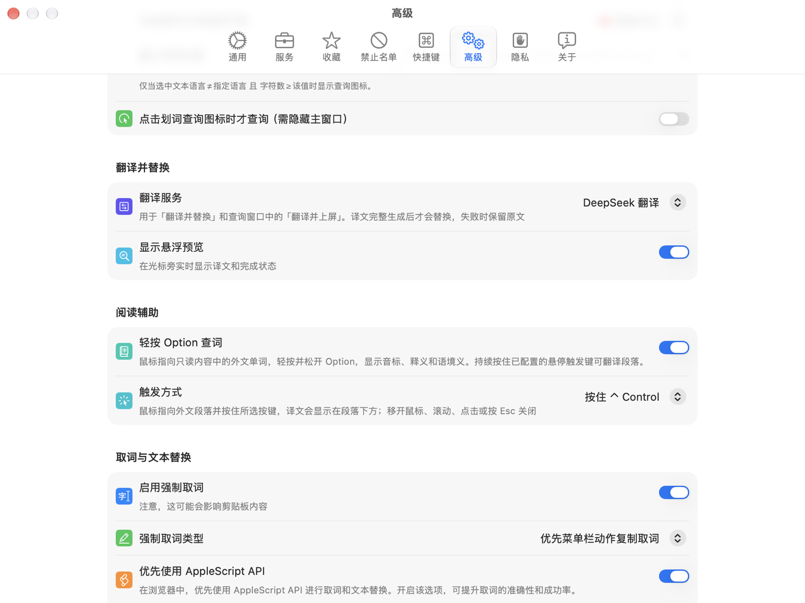
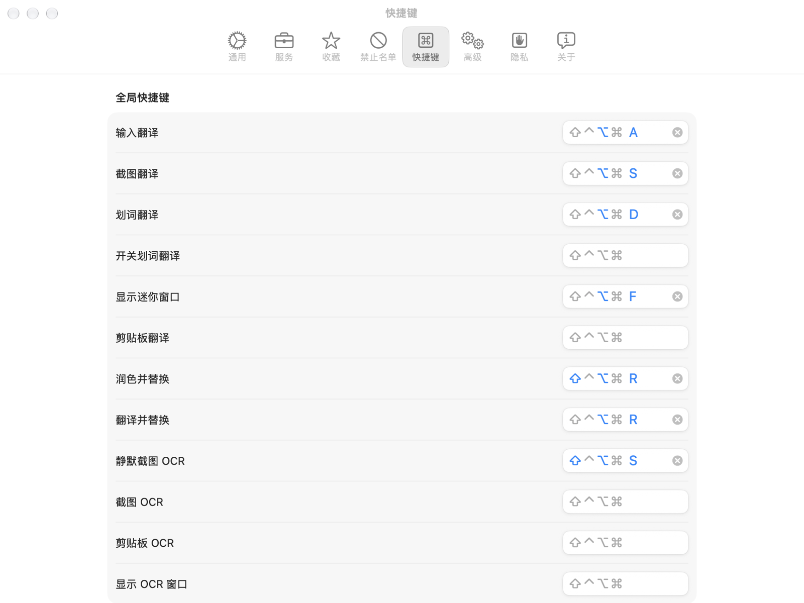
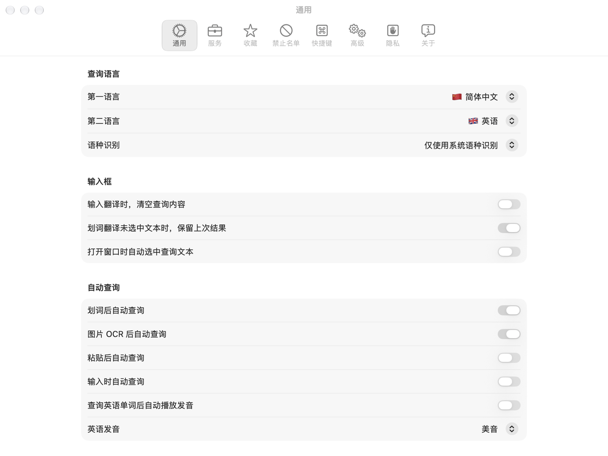
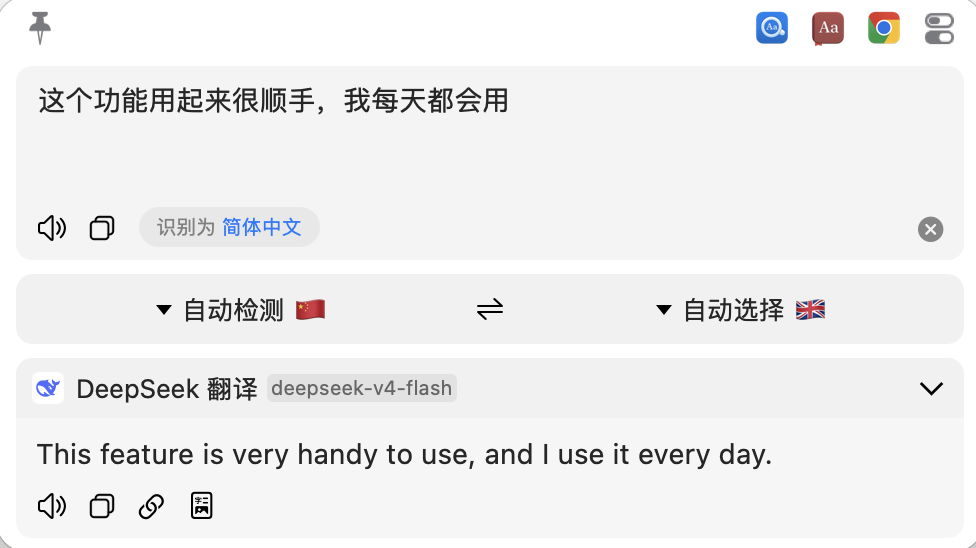
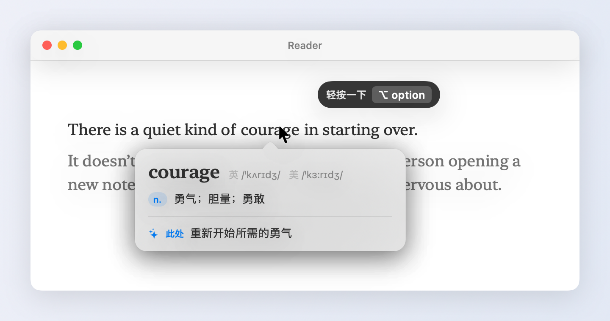

# Easydict Plus

**边读边写的英语助手：打中文秒变英文，指着英文秒出中文。**

基于开源翻译工具 [Easydict](https://github.com/tisfeng/Easydict) 二次开发，专门为"把电脑切成英文、在日常使用中学英语"的人优化。全部功能**只需要配置一个 DeepSeek API Key**，查词部分完全免费。


---

## 目录

- [它能做什么](#它能做什么)
- [和原版 Easydict 相比新增了什么](#和原版-easydict-相比新增了什么)
- [第一步：安装](#第一步安装)
- [第二步：首次设置（5 分钟）](#第二步首次设置5-分钟)
- [第三步：开始使用](#第三步开始使用)
- [费用说明](#费用说明)
- [常见问题](#常见问题)
- [给开发者](#给开发者)
- [致谢与开源协议](#致谢与开源协议)

---

## 它能做什么

| 你想做什么 | 怎么操作 | 效果 |
| --- | --- | --- |
| 打字时把中文变成英文 | 打完中文，按 `⌥R` | 原地替换成英文，任何 App 的输入框都行 |
| 先看看译文再发出去 | `⌥A` 打开小窗口输入中文，按 `⌘↩` | 英文直接打到原来的光标位置 |
| 读懂一整段英文 | 鼠标指着段落，**按住 `⌃`** | 段落下方弹出中文译文 |
| 查一个单词 | 鼠标指向单词，**轻按并松开 ⌥ Option** | 弹出音标、释义，以及它**在这句话里**的意思 |
| 自己写的英文想改得更地道 | 选中英文，按 `⇧⌥R` | AI 帮你润色并原地替换 |

> 键位说明：`⌥` 是 Option 键，`⌃` 是 Control 键，`⌘` 是 Command 键，`⇧` 是 Shift 键，`↩` 是回车键。

---

## 和原版 Easydict 相比新增了什么

- **翻译并替换可以用自己的 AI 服务**：原版固定用内置 AI，现在可以选 DeepSeek 等任意已配置的服务
- **光标旁的悬浮预览卡片**：翻译过程实时可见，完成后显示"✓ 已替换"
- **更安全的替换**：译文完整生成后才替换，失败时保留原文；写入后会核对结果，Claude 桌面版这类 Electron 应用不接受直接写入时，自动改用粘贴；焦点切走时改为复制到剪贴板
- **查询窗口一键上屏**：`⌘↩` 关闭窗口并把译文打到原来的光标位置
- **按住 `⌃` 悬停翻译整段**：不用选中文字，指哪翻哪
- **轻按 Option 查词**：带箭头的词典气泡，附 AI 给出的"此处"语境义
- 默认关闭自动检查官方更新，避免增强版被官方原版覆盖

---

## 第一步：安装

支持 Apple 芯片和 Intel 芯片的 Mac，需要 **macOS 13 或更新版本**。

### 方式一：下载安装包（推荐）

1. 打开 [Releases 页面](https://github.com/pairslab/easydict-plus/releases/latest)，下载最新的 `EasydictPlus-版本号.dmg`。
2. 双击打开 DMG，把 **Easydict Plus** 拖到旁边的 **Applications（应用程序）** 文件夹。
3. **第一次打开需要手动放行**。因为没有苹果开发者签名，macOS 会提示"无法验证开发者"或"Apple 无法验证其是否包含恶意软件"。下面两种方法任选一种，只需做一次：
   - **方法 A**：先双击打开一次，在弹窗里点"完成"。然后打开 **系统设置 → 隐私与安全性**，滚到最下面，在"已阻止使用 Easydict Plus"旁点 **"仍要打开"**，输入开机密码确认。
   - **方法 B**：打开"终端"，运行下面这行命令，然后再双击打开：

     ```bash
     xattr -dr com.apple.quarantine "/Applications/Easydict Plus.app"
     ```

4. 打开后，屏幕右上角的菜单栏会出现 Easydict 图标，接着看[第二步](#第二步首次设置5-分钟)。

> - Easydict Plus 和官方版 Easydict 是**两个独立的 App**，设置互不影响。两个同时运行时快捷键会冲突，建议只开一个。
> - 安装包可以用 Releases 页面里的 `.sha256` 文件校验完整性：`shasum -a 256 EasydictPlus-版本号.dmg`。

### 方式二：从源码编译

适合想自己改代码的人。第一次编译大约 10～20 分钟（下载依赖比较慢）。

**需要准备**：从 App Store 安装的 **Xcode**。

1. 下载代码（在"终端"里运行）：

   ```bash
   git clone https://github.com/pairslab/easydict-plus.git
   ```

2. 用 Xcode 打开项目文件夹里的 **`Easydict.xcworkspace`**（注意不是 `.xcodeproj`）。
3. 窗口顶部的 Scheme 选择 **Easydict**，按 `⌘R` 编译运行。
4. 运行成功后，屏幕右上角的菜单栏会出现 Easydict 图标。
5. 想长期使用的话：在 Xcode 菜单里选 **Product → Show Build Folder in Finder**，进入 `Products/Debug`，把 `Easydict-debug.app` 拖进"应用程序"文件夹，以后直接打开它即可。

> **小提示**：默认的临时签名，会让 macOS 在每次重新编译后要求你重新授权辅助功能。如果你有 Apple 开发者证书，在项目目录运行 `./scripts/setup-team.sh` 就能避免这个问题。

---

## 第二步：首次设置（5 分钟）

### 1. 打开辅助功能权限

替换文字、读取鼠标下的段落都需要这个权限。

打开 **系统设置 → 隐私与安全性 → 辅助功能**（新版 macOS 叫"设备控制和数据访问"），找到 **Easydict** 并打开开关。如果列表里没有，点左下角的 **+** 把 App 加进去。

### 2. 申请 DeepSeek API Key

1. 打开 [DeepSeek 开放平台](https://platform.deepseek.com)，注册并登录。
2. 充值一点余额（几块钱就能用很久，见[费用说明](#费用说明)）。
3. 在 **API Keys** 页面点"创建 API Key"，复制以 `sk-` 开头的那串字符。

> API Key 相当于你账户的密码，不要发给别人，也不要提交到代码仓库里。

### 3. 在 Easydict 里填入 DeepSeek

点菜单栏的 Easydict 图标 → **设置** → **服务**：

1. 左边的列表里如果没有"DeepSeek 翻译"，点下方的 **+** 添加。
2. 把 DeepSeek **拖到列表第一位**（`⌘↩` 上屏用的是第一个服务的结果）。不需要的服务可以关掉开关。
3. 在右边粘贴 **API Key**。
4. **思考程度**选 **关闭**，翻译会快很多，也更省钱。



### 4. 让"翻译并替换"使用 DeepSeek

**设置 → 高级 → 翻译并替换 → 翻译服务**，选 **DeepSeek 翻译**。

同一页的 **阅读辅助** 里可以开关"轻按 Option 查词"，也可以修改悬停翻译的触发键（`⌃` / `⌥` / `⇧` / 关闭）。



### 5. 确认快捷键

Easydict Plus 首次启动时已经设好了常用快捷键，在 **设置 → 快捷键** 里可以查看和修改：

- **翻译并替换**：`⌥R`
- **润色并替换**：`⇧⌥R`
- **输入翻译**（打开小窗口）：`⌥A`
- **划词翻译**：`⌥D`

查询窗口里的 **翻译并上屏** 默认是 `⌘↩`，在同一页下方的"应用内快捷键"里。



### 6. 确认语言

**设置 → 通用 → 查询语言**：第一语言选 **简体中文**，第二语言选 **英语**。

这样输入中文会翻成英文，输入英文会翻成中文。把系统语言切换成英文之后，这个规则依然有效。



设置完成，可以开始用了。

---

## 第三步：开始使用

### 打字时：`⌥R` 原地中译英

在任何输入框（微信、浏览器、邮件、备忘录……）里照常打中文，按 `⌥R`。光标旁会出现一张小卡片，实时显示翻译进度，大约 1 秒后中文就变成了英文。

- 不用先选中文字：没选中时，会自动翻译整个输入框的内容
- 只想翻其中一句：先选中那一句再按 `⌥R`
- 反过来也可以：选中英文按 `⌥R`，就变成中文


### 先看看再发：`⌥A` 输入，`⌘↩` 上屏

按 `⌥A` 打开输入窗口，输入中文，DeepSeek 的译文会显示在下方。确认没问题后按 `⌘↩`，窗口自动关闭，英文会出现在你原来打字的位置。



### 读整段英文：按住 `⌃`

鼠标指着网页、文档里的任意一段外文，**按住 `⌃` 键**：

1. 这一段周围出现一圈淡淡的高亮框，告诉你要翻译的范围
2. 按住不放、移动鼠标，高亮框会跟着在段落之间滑动
3. 停留片刻，或者直接松开 `⌃`，段落正下方就会淡入中文译文
4. 鼠标移开、滚动页面、点击或按 Esc，卡片自动消失

看过的段落再看时会直接显示，不会重复消耗 API。中文段落不会弹出卡片。效果图见本页顶部。

### 查单词：轻按 Option

在支持辅助功能取词的网页、PDF 等**只读**内容中，把鼠标指向英文单词，单独轻按并松开 **⌥ Option**，单词下方会弹出词典气泡：

- **音标和释义**：来自有道词典（免费），查不到时自动使用 Mac 自带的词典（离线）
- **✦ 此处**：DeepSeek 结合你正在读的这句话，告诉你这个词在这里的具体意思

无需选中文字或点击鼠标。双击恢复普通选词行为；输入框内不触发词典气泡。组合快捷键不会触发查词。

如果段落翻译也使用 Option，轻按后松开查单词，持续按住约半秒才开始识别并翻译段落；轻按期间不会高亮整段或发送段落翻译请求。其他段落触发键仍立即开始识别。



### 练习写作：`⇧⌥R` 润色

先自己用英文写，写得不地道也没关系。选中后按 `⇧⌥R`，Easydict 内置的免费 AI 会帮你改得更自然。

**学习建议**：别全靠 `⌥R`。先自己写，再用 `⇧⌥R` 看看 AI 改了哪里，这样进步最快。

---

## 费用说明

| 部分 | 费用 |
| --- | --- |
| 单词查词的音标和释义 | **免费**（有道网页词典，无需 API Key；系统词典离线免费） |
| `⇧⌥R` 润色 | **免费**（使用 Easydict 内置 AI，高峰期可能限流） |
| 翻译、上屏、悬停翻译、"此处"语境义 | 使用你的 DeepSeek 账户，按用量计费 |

翻译一句话通常只消耗几百个 token。按 DeepSeek 官方价格估算，每天翻译两三百次，一个月一般也就几块钱人民币以内。实际价格请以 [DeepSeek 官方价格页](https://api-docs.deepseek.com/zh-cn/quick_start/pricing) 为准。

---

## 常见问题

**按快捷键没有反应？**

1. 确认菜单栏里有 Easydict 图标（没有说明 App 没在运行）。
2. 确认已经打开辅助功能权限。**升级到新版本或重新编译后**，macOS 会把它当成新 App：到辅助功能列表里选中旧的 Easydict Plus，点 **−** 删掉，再重新添加并打开开关。

**打开时提示"已损坏，无法打开"或"无法验证开发者"？**

这是因为安装包没有苹果开发者签名，并不是文件真的坏了。按[安装步骤](#方式一下载安装包推荐)里的方法 A 或方法 B 放行一次即可。

**卡片显示"已复制，按 ⌘V 粘贴"？**

翻译期间你切换到了别的 App，或者当前 App 不允许直接写入文字。译文已经在剪贴板里，按 `⌘V` 粘贴即可。

**按住 `⌃` 没有反应？**

- 需要单独按住 `⌃` 约 0.3 秒，中途按了别的键会自动取消（这样 `⌃⌘空格` 之类的快捷键不会误触发）
- 少数 App 不对外提供文字内容，在那里指着不会有反应，这时可以选中文字后按 `⌥D` 翻译
- 中文段落本来就不会弹出卡片

**轻按 Option 没有弹出词典气泡？**

确认鼠标停在只读单词上，单独轻按并松开按键，且 **设置 → 高级 → 阅读辅助 → 轻按 Option 查词** 已打开。输入框和未提供单词位置的辅助功能内容不会触发查词；双击仍按普通选词处理。

**怎么升级？会不会被官方版本覆盖？**

不会。Easydict Plus 有自己独立的身份，应用内的"检查更新"只会查询本仓库，不会装上官方版。有新版本时，到 [Releases 页面](https://github.com/pairslab/easydict-plus/releases) 下载新的 DMG，拖进"应用程序"覆盖旧版即可，设置和 API Key 都会保留。

升级后需要重新授权一次辅助功能：安装包没有苹果开发者签名，系统会把新版当成另一个 App，旧授权的开关虽然还亮着，但已经不起作用。到 **系统设置 → 隐私与安全性 → 辅助功能**，选中旧的 Easydict Plus 点"−"删掉，再点"+"添加 `/Applications/Easydict Plus.app` 并打开开关。

**会上传我的使用数据吗？**

不会。原版的正式版会向原作者的服务器发送崩溃日志和匿名统计，Easydict Plus 已经关掉了这部分上报。翻译时，文字只会发送给你配置的翻译服务（比如 DeepSeek）。

**想关掉某个功能？**

都在 **设置 → 高级** 里：替换翻译的悬浮预览、轻按 Option 查词、悬停翻译的触发键都可以单独关闭。

---

## 给开发者

- **新增代码**：
  - `Easydict/Swift/Feature/ReadingAssist/`：悬停翻译和轻按 Option 查词
  - `Easydict/Swift/Feature/ActionManager/`：翻译并替换、翻译卡片、上屏
- **每次改动的记录**：`docs/histories/2026-10/`
- **编码规范与 Agent 开发说明**：沿用原项目的 [`AGENTS.md`](AGENTS.md) 和 [`CONTRIBUTING.md`](CONTRIBUTING.md)
- **同步原作者的更新**：

  ```bash
  git remote add upstream https://github.com/tisfeng/Easydict.git
  git fetch upstream
  git merge upstream/dev
  ```

---

## 致谢与开源协议

本项目基于 [tisfeng/Easydict](https://github.com/tisfeng/Easydict) 二次开发，感谢原作者和所有贡献者。原版说明请见 [README_ZH.md](README_ZH.md)（中文）和 [README_UPSTREAM.md](README_UPSTREAM.md)（English）。

与原项目一致，本项目以 [GPL-3.0](LICENSE) 协议开源。
